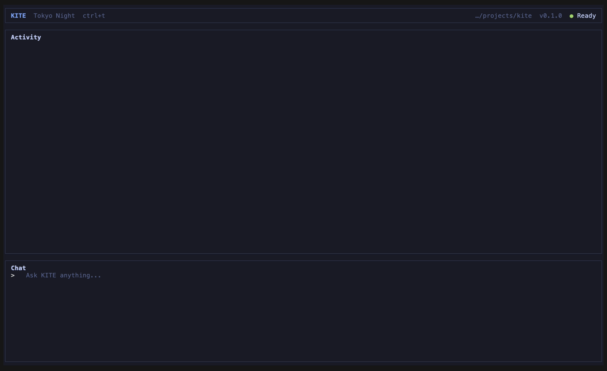

# Kite

A minimal coding agent that runs in your terminal, built from scratch in Go.



## What it can do (v0.1.0)

- Answer questions, and read the files in your project to answer them.
- List files, read files, and create new files in folders that already exist. It never overwrites or deletes.
- Split a bigger request into tasks, run them one by one, and check each one before moving on.
- Retry failed requests, stop at a limit, time out after a minute, and cancel with Esc.

It cannot run commands or edit existing files yet.

## Getting started

You need [Go](https://go.dev/dl/) 1.26 or newer and an API key for any OpenAI-compatible chat endpoint (the example uses Gemini).

```bash
git clone https://github.com/Prathamesh017/KITE.git
cd KITE
cp .env.example .env   # then put your API key in .env
go run ./cmd/main.go
```

With [Task](https://taskfile.dev) installed, you can use `task run` instead.

## Using it

Type a question in the chat panel and press Enter.

| Key | What it does |
| --- | --- |
| Enter | Send the question |
| Esc | Cancel the running question |
| ctrl+t | Switch theme |
| up / down | Scroll |
| ctrl+c | Quit |

Try:

- `what does cmd/main.go do?`
- `summarize main.go and write it to notes.md`

## Configuration

Set in `.env` (see `.env.example`):

| Variable | Default | Meaning |
| --- | --- | --- |
| `API_KEY` | required | Your API key |
| `TEXT_MODEL_NAME` | required | The model to use |
| `API_URL` | required | The chat-completions endpoint |
| `REQUEST_TIMEOUT` | `60s` | Time limit for one model request |
| `MAX_RETRIES` | `3` | Retries for a failed request |
| `RETRY_INITIAL_DELAY` / `RETRY_MAX_DELAY` | `500ms` / `8s` | Backoff between retries |
| `MAX_ITERATIONS` | `10` | Model replies per question or task |
| `MAX_TOOL_CALLS` | `20` | Tool calls per question or task |
| `MAX_TOOL_OUTPUT_BYTES` | `32768` | Largest tool result sent to the model |

## Safety

- Kite only works inside the folder you start it in.
- `read_file` will not open `.env`, `.env.*`, `*.pem`, or anything under `.git/`.
- `write_file` only creates new files. Before a task run starts, Kite stops if any file the tasks would create already exists.

## Development

```bash
task test    # run all tests
task debug   # run under Delve, then attach with "Attach to kite"
```

